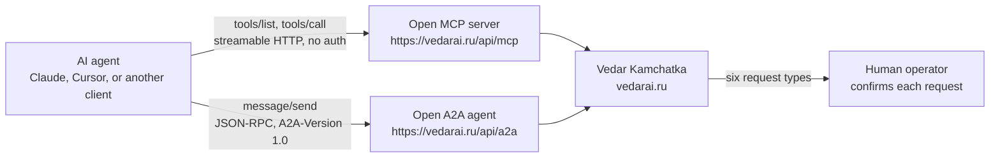

# Vedar Kamchatka — open MCP server and A2A agent

Examples and a short guide for the **open MCP server** and **open A2A agent** of [Vedar Kamchatka](https://vedarai.ru) (Ведар Камчатка): an information portal about Kamchatka, Russia, and an AI guide. Vedar Kamchatka is not a travel agency and not a tour operator.

This repository documents public HTTP endpoints. It is not the source code of the portal. You can call the server from Claude Desktop, Cursor, or any MCP / A2A client — no account and no API key.

- Portal: [https://vedarai.ru](https://vedarai.ru)
- Protocol docs on the portal: [https://vedarai.ru/mcp](https://vedarai.ru/mcp)
- MCP specification: [modelcontextprotocol.io](https://modelcontextprotocol.io)
- A2A specification: [a2a-protocol.org](https://a2a-protocol.org)

## What you can do

The open MCP server and the open A2A agent expose the same tools. They return live catalogue data from the portal: operator tours and availability, place and route safety context, regional safety status, weather, volcano status, stays, gear, transfers, self-drive car rental, and trip plans.

There are **six request types**. A request is not a booking. Each request is confirmed by a person. Vedar Kamchatka does not take payment: a traveller pays the operator or partner directly when they agree to work together.

The six request tools are:

| Tool | What the request is for | Required arguments |
| --- | --- | --- |
| `create_trip_request` | A trip as a whole (tour, stay, and/or transfer together) | `name`, `phone`, `consent` |
| `create_lead` | Help choosing a trip | `name`, `phone`, `comment`, `consent` |
| `create_booking_request` | A named tour on a date (a request, not a booking) | `tour`, `date`, `name`, `phone`, `consent` |
| `create_stay_request` | A stay on given dates | `accommodation`, `name`, `phone`, `consent` |
| `request_charter` | A whole vehicle (charter / transfer) | `destination`, `date_from`, `name`, `phone`, `consent` |
| `create_car_rental_request` | Self-drive car rental | `car`, `name`, `phone`, `consent` |

`consent` must be `true`, and only after the person has agreed that their name and phone may be processed and passed to the relevant partners. Ask for the name and phone; do not invent them.

To try a write-type call without storing anything or notifying anyone, pass `test: true`. The examples in this repository use a dry run only.

`make_trip_plan` and `edit_trip_plan` save an anonymous plan draft for 7 days. They do not take a name or phone, and no person receives the draft. `get_request_status` and `change_request` work with the status key returned for a request; `change_request` cancels a tour request or moves it to another date, and only when the person asks.

## How the pieces fit together



## Open MCP server

- Endpoint: `https://vedarai.ru/api/mcp`
- Transport: [streamable HTTP](https://modelcontextprotocol.io/specification/2025-03-26/basic/transports#streamable-http), no authentication
- Docs: [https://vedarai.ru/mcp](https://vedarai.ru/mcp)

A live `initialize` call on 13 November 2026 returned protocol version `2025-03-26`, server name `vedar-mcp`, title «Ведар — Камчатка», version `2.10.1`. A live `tools/list` call returned the 25 tools listed below. Send `Content-Type: application/json` and `Accept: application/json, text/event-stream`.

### Connect from Claude Desktop or Cursor

Add this snippet to the MCP config (Claude Desktop: `claude_desktop_config.json`; Cursor: `mcp.json`). No API key is required.

```json
{
  "mcpServers": {
    "vedar-kamchatka": {
      "type": "http",
      "url": "https://vedarai.ru/api/mcp"
    }
  }
}
```

If your client expects only a URL, this is enough:

```json
{
  "mcpServers": {
    "vedar-kamchatka": {
      "url": "https://vedarai.ru/api/mcp"
    }
  }
}
```

### curl: initialize and tools/list

```bash
curl -sS https://vedarai.ru/api/mcp \
  -H "Content-Type: application/json" \
  -H "Accept: application/json, text/event-stream" \
  -d '{
    "jsonrpc": "2.0",
    "id": 1,
    "method": "initialize",
    "params": {
      "protocolVersion": "2025-03-26",
      "capabilities": {},
      "clientInfo": { "name": "vedar-docs", "version": "0.1.0" }
    }
  }'
```

```bash
curl -sS https://vedarai.ru/api/mcp \
  -H "Content-Type: application/json" \
  -H "Accept: application/json, text/event-stream" \
  -d '{"jsonrpc":"2.0","id":2,"method":"tools/list","params":{}}'
```

A read-only tool call looks like this:

```bash
curl -sS https://vedarai.ru/api/mcp \
  -H "Content-Type: application/json" \
  -H "Accept: application/json, text/event-stream" \
  -d '{
    "jsonrpc": "2.0",
    "id": 3,
    "method": "tools/call",
    "params": {
      "name": "get_volcano_status",
      "arguments": { "volcano": "Шивелуч" }
    }
  }'
```

## Open A2A agent

- Agent card: [https://vedarai.ru/.well-known/agent-card.json](https://vedarai.ru/.well-known/agent-card.json) (version `2.10.1` when last fetched)
- JSON-RPC endpoint: `https://vedarai.ru/api/a2a`
- Required header: `A2A-Version: 1.0`
- There is also an HTTP+JSON interface at `https://vedarai.ru/api/a2a/v1` (same protocol version). The examples below use JSON-RPC.

Send a free-text question as a text part, or call a tool exactly with a DataPart of the form `{"tool": "<name>", "arguments": { ... }}`. Tool names and argument schemas are the same as in MCP `tools/list`.

### curl: message/send dry run (`test: true`)

This calls `create_lead` as a dry run. The server runs the same checks as a real request, but stores nothing and notifies no one.

```bash
curl -sS https://vedarai.ru/api/a2a \
  -H "Content-Type: application/json" \
  -H "A2A-Version: 1.0" \
  -d '{
    "jsonrpc": "2.0",
    "id": 1,
    "method": "message/send",
    "params": {
      "message": {
        "messageId": "11111111-1111-1111-1111-111111111111",
        "role": "user",
        "parts": [
          {
            "kind": "data",
            "data": {
              "tool": "create_lead",
              "arguments": {
                "name": "Dry Run Example",
                "phone": "+79990000000",
                "comment": "Dry-run check of the open A2A agent; not a real request.",
                "consent": true,
                "test": true
              }
            }
          }
        ]
      }
    }
  }'
```

A successful dry run completes the task and says the request was not recorded (`test: true`, `accepted: 0`). Do not show that result to a traveller as an accepted request.

## Tools on the live server

These names come from a live `tools/list` call (25 tools, version `2.10.1`). Use them as-is.

**Catalogue and facts**

- `get_tours` — operator tours, prices and dates (optional `activity_type`, `page`)
- `get_tour_details` — one tour in depth (`name` required)
- `get_tour_availability` — live places for a tour
- `compare_tours` — compare tours
- `search_accommodations` — stays from platform partners
- `search_transfers` — whole-vehicle charters
- `search_car_rental` — self-drive rental
- `search_gear` — gear rental
- `get_place_info` — place facts on record (`name` required)
- `get_guardian_context` — safety context for a place or route (`place` required)
- `get_weather` — daily forecast (Open-Meteo)
- `get_volcano_status` — KVERT aviation code and KB GS RAS seismicity
- `safety_status` — regional safety alerts
- `search`, `fetch` — search and fetch portal pages

**Trip plans** (anonymous draft, 7 days, no name or phone)

- `make_trip_plan`
- `edit_trip_plan`

**Requests** (each confirmed by a person; a request is not a booking; no payment through Vedar Kamchatka)

- `create_trip_request`, `create_lead`, `create_booking_request`, `create_stay_request`, `request_charter`, `create_car_rental_request`
- `get_request_status` — status by key
- `change_request` — cancel a tour request or move it to another date, only when the person asks (`test: true` for a dry run)

## Examples in this repository

Working scripts live in [`examples/`](examples/). They were checked against the live endpoints with read-only calls and a `test: true` dry run only.

- [`examples/mcp_curl.sh`](examples/mcp_curl.sh) — MCP `initialize`, `tools/list`, and a read-only `tools/call`
- [`examples/a2a_dry_run.sh`](examples/a2a_dry_run.sh) — A2A `message/send` with `create_lead` and `test: true`
- [`examples/vedar_client.py`](examples/vedar_client.py) — the same three MCP calls plus the A2A dry run, in Python 3 (standard library only)

```bash
chmod +x examples/*.sh examples/vedar_client.py
./examples/mcp_curl.sh
./examples/a2a_dry_run.sh
python3 examples/vedar_client.py
```

## По-русски

«Ведар Камчатка» — информационный портал о Камчатке и ИИ-проводник, не турагентство и не туроператор.

Открытый MCP-сервер: [https://vedarai.ru/api/mcp](https://vedarai.ru/api/mcp) (streamable HTTP, без ключа). Описание: [https://vedarai.ru/mcp](https://vedarai.ru/mcp).

Открытый A2A-агент: карточка [https://vedarai.ru/.well-known/agent-card.json](https://vedarai.ru/.well-known/agent-card.json), JSON-RPC [https://vedarai.ru/api/a2a](https://vedarai.ru/api/a2a), заголовок `A2A-Version: 1.0`.

Заявок шесть, каждую подтверждает человек. Заявка — не бронь. Оплату Ведар Камчатка не принимает. Пишущие вызовы в примерах идут только с `test: true`: заявка не записывается и никому не уходит.
